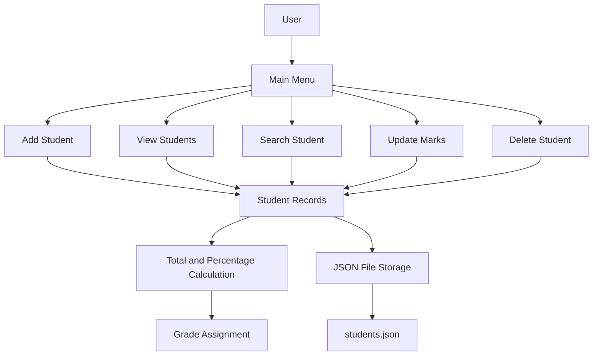

# Student Grade Management System

A menu-driven application developed using Python to manage student records, subject marks, and academic performance. The system provides essential student record management operations and automatically calculates total marks, percentages, and grades. Student data is stored locally using JSON file handling.

## Overview

The Student Grade Management System simplifies the process of maintaining student academic records. It allows users to add, view, search, update, and delete student information through an interactive command-line interface.

The application automates grade calculation based on student marks and provides persistent storage so records can be accessed across program executions.

## Features

- **Add Student:** Register student details, subjects, and marks.
- **View Students:** Display all registered student records.
- **Search Student:** Retrieve student information using Student ID.
- **Update Marks:** Modify marks for a particular subject.
- **Delete Student:** Remove student records from the system.
- **Total Calculation:** Calculate the total marks obtained.
- **Percentage Calculation:** Calculate the average percentage across subjects.
- **Grade Assignment:** Automatically assign grades based on percentage.
- **Input Validation:** Validate marks within the allowed range.
- **Persistent Storage:** Save and retrieve student records using JSON.

## Technologies Used

| Technology | Purpose |
|---|---|
| Python 3 | Core programming language |
| JSON | Student data storage |
| `json` module | Reading and writing student records |
| `os` module | File existence checking |
| VS Code | Development environment |
| Git & GitHub | Version control and project hosting |

## System Architecture



## Project Structure

```text
Student-Grade-Management-System/
│
├── student_grade_management.py
├── students.json
└── README.md
```

| File | Description |
|---|---|
| `student_grade_management.py` | Contains the main program, menu, student operations, and grade calculation logic. |
| `students.json` | Stores student information and marks persistently. Created when student records are saved. |
| `README.md` | Project documentation. |

## Grade Calculation

The system calculates the total marks and average percentage from the subjects entered by the user.

| Percentage | Grade |
|---|---|
| 90–100% | A+ |
| 80–89.99% | A |
| 70–79.99% | B |
| 60–69.99% | C |
| 50–59.99% | D |
| Below 50% | F |

## Installation and Setup

### Prerequisites

- Python 3.x
- Git
- Visual Studio Code (recommended)

No third-party Python packages are required.

### 1. Clone the repository

```bash
git clone https://github.com/gosettisowmya/Student-Grade-Management-System.git
```

### 2. Navigate to the project directory

```bash
cd Student-Grade-Management-System
```

### 3. Run the application

```bash
python student_grade_management.py
```

## Application Menu

```text
===== Student Grade Management System =====

1. Add Student
2. View All Students
3. Search Student
4. Update Student Marks
5. Delete Student
6. Exit
```

## How It Works

1. The application loads existing student records from the JSON file.
2. The user selects an operation from the main menu.
3. Student information and subject marks are entered or modified.
4. The application calculates total marks, percentage, and grade when displaying student results.
5. Updated student information is saved to the JSON file.
6. Stored records are available the next time the application is executed.

## Python Concepts Demonstrated

- Functions and modular programming
- Dictionaries and data structures
- Loops and conditional statements
- User input handling
- File handling
- JSON serialization and deserialization
- CRUD operations (Create, Read, Update, Delete)
- Exception handling and input validation

## Future Enhancements

- Graphical user interface using Tkinter
- Database integration using SQLite or MySQL
- Student ranking and class topper functionality
- Export reports to Excel or CSV
- Subject-wise performance analysis
- Improved input validation and reporting

## Author

**Gosetti Sowmya**

GitHub: [gosettisowmya](https://github.com/gosettisowmya)

---

If you find this project useful, feel free to explore the repository and contribute improvements.
